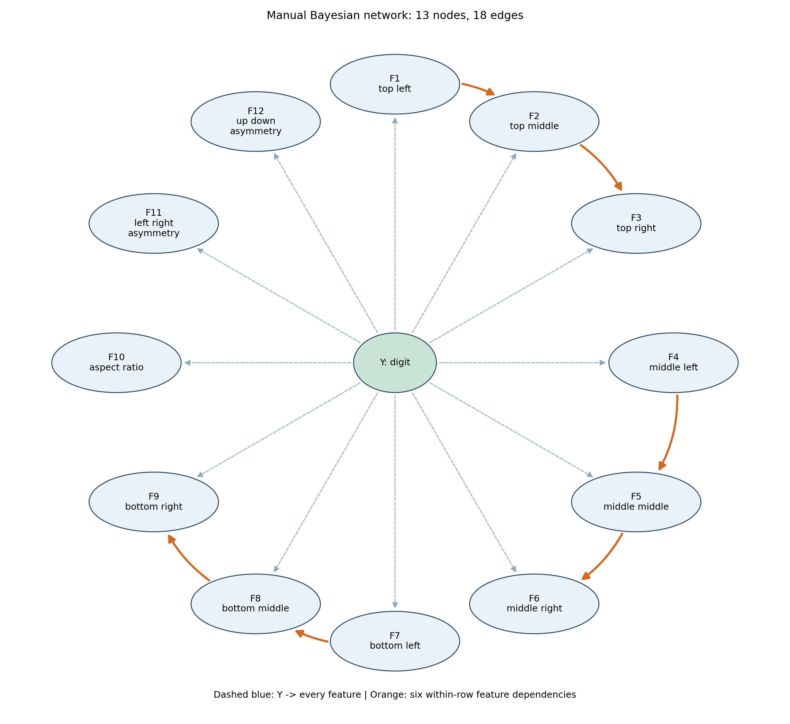
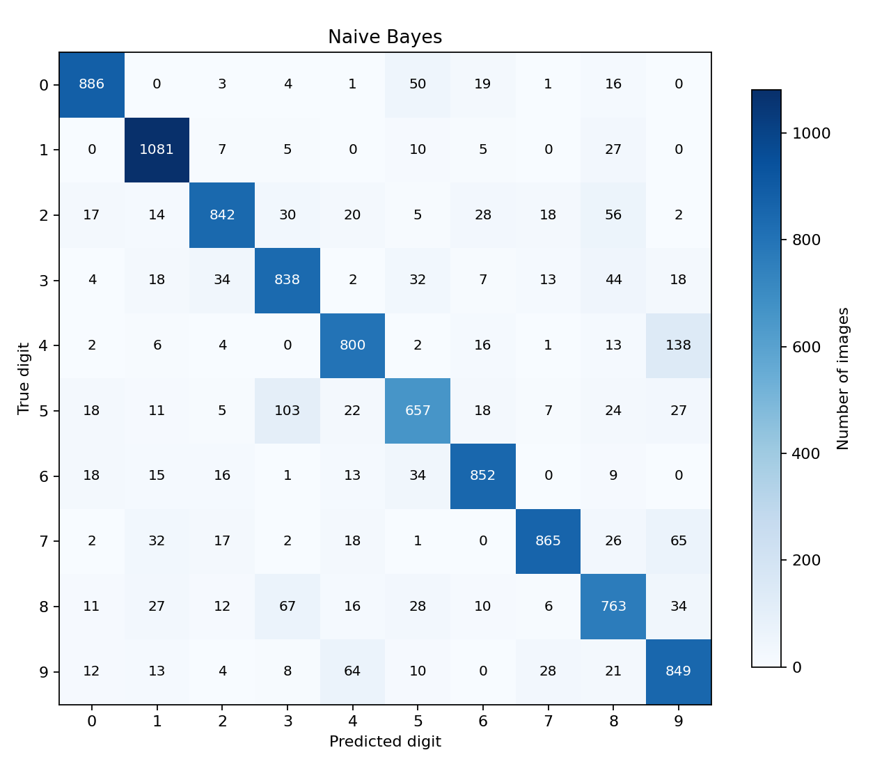
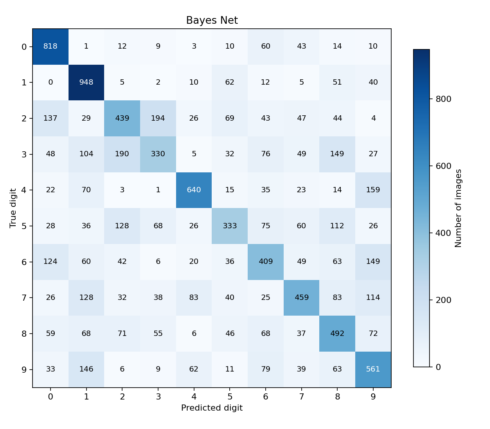
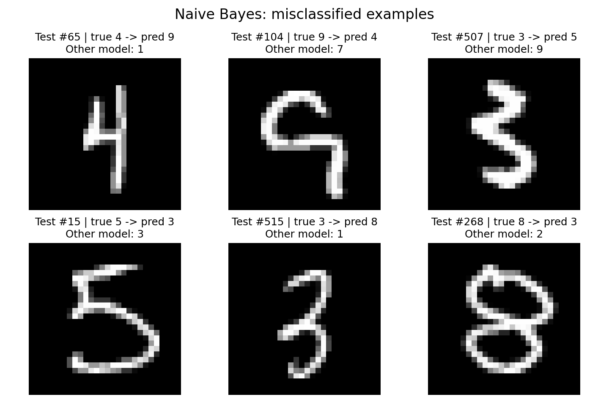
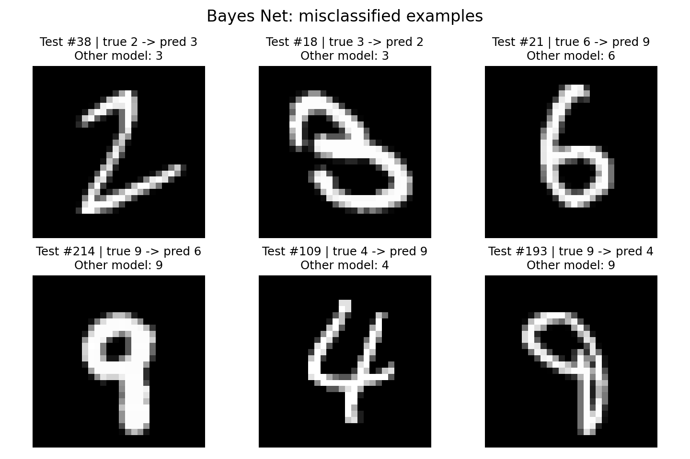

# 手写数字识别：朴素贝叶斯与小型贝叶斯网络

实验日期：2026-10-23。数据：课程提供的标准 MNIST。任务：预测 0–9 共 10 个数字类别。


## 1. 总体设计

本实验实现两个概率分类器：使用 784 个二值像素的 Bernoulli Naive Bayes，以及使用 12 个离散图像特征的手工 Bayesian Network。核心概率估计、平滑、预测和评价指标均使用 NumPy 自行实现；Matplotlib 只用于绘图。没有调用 sklearn 分类器、pgmpy、bnlearn 或自动结构学习算法。

数据处理流程如下：

1. 解压课程提供的 MNIST 数据；根据 `manifest.json` 核对四个数据文件的 SHA256。
2. 读取 gzip 内的 IDX 数据头与数据体，检查训练图像为 `(60000,28,28)`、测试图像为 `(10000,28,28)`。
3. 把图像展平为 `(n_samples,784)`，保留原始 0–255 像素作为模型的公共输入。
4. 模型内部使用 `pixel > 128` 二值化；朴素贝叶斯直接使用二值像素，贝叶斯网络再提取离散特征。
5. 在全部 60,000 张训练图像上估计参数，在全部 10,000 张测试图像上预测，输出指标、混淆矩阵和误分类图。

两个模型均使用 `alpha=1.0`，包括类别先验与条件概率的加一平滑。预处理阈值、特征分箱边界和网络结构在本次测试前固定，没有搜索超参数或根据测试结果重新选择模型。由于没有进行调参，本次未另划验证集；未来改进应先从训练集划分验证集，避免把测试集用于模型选择。

输入检查覆盖形状、像素范围、有限值及标签取值。训练接口返回 `self`；预测返回长度为样本数的一维整数数组。两个模型文件均仅依赖 NumPy，可独立由评测程序加载。

## 2. Naive Bayes 算法

### 2.1 条件独立与分类规则

设二值像素为 $b_j=\mathbf{1}[x_j>128]$。由贝叶斯公式，后验正比于先验与似然的乘积。给定数字类别后，假设 784 个像素相互条件独立：

$$
P(y\mid b)\propto P(y)\prod_{j=1}^{784}P(b_j\mid y).
$$

这里的条件独立是建模近似；真实笔画会使相邻像素相关。记训练样本数为 $N$，类别 $c$ 的样本数为 $N_c$，该类第 $j$ 个像素为 1 的样本数为 $N_{cj}^{(1)}$：

$$
\widehat P(y=c)=\frac{N_c+\alpha}{N+10\alpha},\qquad
\theta_{cj}=\widehat P(b_j=1\mid y=c)=\frac{N_{cj}^{(1)}+\alpha}{N_c+2\alpha}.
$$

二值变量有两个可能值，所以条件概率分母加入 $2\alpha$。背景概率为 $1-\theta_{cj}$；预测同时利用前景和背景，不能只累加有墨迹像素。

### 2.2 对数概率与实现

逐类别计算：

$$
s_c=\log\widehat P(c)+\sum_{j=1}^{784}\left[b_j\log\theta_{cj}+(1-b_j)\log(1-\theta_{cj})\right],
\quad \hat y=\arg\max_c s_c.
$$

对数将连乘转换为加法，避免大量小概率连乘产生下溢。代码等价地整理为矩阵乘法：

$$
s_c=\log\widehat P(c)+\sum_j\log(1-\theta_{cj})
+\sum_j b_j\left[\log\theta_{cj}-\log(1-\theta_{cj})\right].
$$

平滑保证没有出现过的像素事件也有正概率，不会让某类别得分变成负无穷。可选的 `predict_proba` 先减去最大对数分数，再指数化、归一化，返回模型后验；这些值没有经过概率校准，不宜直接当作可靠的现实置信度。

## 3. 小型手工贝叶斯网络

### 3.1 十二个特征及离散化

先将图像按同样阈值二值化。行列从 0 开始，区间写作 Python 左闭右开形式。图像中央 `[2:26,2:26]` 的 24×24 区域划分为 3×3 网格，每格 8×8 像素。区域密度为该格中值为 1 的像素比例。

| 特征 | 语义 | 计算区域或方式 | 分箱 |
|---|---|---|---|
| F1 | 左上区域墨迹密度 | 行 `[2:10]`，列 `[2:10]` | 密度分箱 |
| F2 | 中上区域墨迹密度 | 行 `[2:10]`，列 `[10:18]` | 密度分箱 |
| F3 | 右上区域墨迹密度 | 行 `[2:10]`，列 `[18:26]` | 密度分箱 |
| F4 | 左中区域墨迹密度 | 行 `[10:18]`，列 `[2:10]` | 密度分箱 |
| F5 | 中央区域墨迹密度 | 行 `[10:18]`，列 `[10:18]` | 密度分箱 |
| F6 | 右中区域墨迹密度 | 行 `[10:18]`，列 `[18:26]` | 密度分箱 |
| F7 | 左下区域墨迹密度 | 行 `[18:26]`，列 `[2:10]` | 密度分箱 |
| F8 | 中下区域墨迹密度 | 行 `[18:26]`，列 `[10:18]` | 密度分箱 |
| F9 | 右下区域墨迹密度 | 行 `[18:26]`，列 `[18:26]` | 密度分箱 |
| F10 | 前景包围盒宽高比 | 完整 28×28 图像的前景包围盒宽 / 高 | 宽高比分箱 |
| F11 | 左右不对称程度 | 原二值图与左右镜像不同的像素比例 | 不对称分箱 |
| F12 | 上下不对称程度 | 原二值图与上下镜像不同的像素比例 | 不对称分箱 |

每个特征取值均为整数 0、1、2、3、4，满足每变量 2–5 个离散值的要求。固定分箱如下，恰好等于边界时进入右侧区间：

| 类型 | 编码 0 | 编码 1 | 编码 2 | 编码 3 | 编码 4 |
|---|---|---|---|---|---|
| 密度 | `[0,0.08)` | `[0.08,0.20)` | `[0.20,0.40)` | `[0.40,0.60)` | `[0.60,1]` |
| 宽高比 | `[0,0.35)` | `[0.35,0.55)` | `[0.55,0.75)` | `[0.75,0.95)` | `[0.95,+∞)` |
| 不对称程度 | `[0,0.04)` | `[0.04,0.08)` | `[0.08,0.12)` | `[0.12,0.18)` | `[0.18,1]` |

全空白图像的宽高比约定为 0，不发生除零。左右、上下不对称程度在完整图像上计算，数值越小越对称。区域密度表示墨迹的粗略空间分布；宽高比刻画狭长程度；镜像差异刻画整体形状。这些特征具有可解释性，但未直接表示环、开口和笔画连通性。

### 3.2 DAG 结构与各边含义



图中虚线表示类别节点指向所有特征，橙色实线表示特征之间的依赖。网络共 13 个节点、18 条有向边。`Y` 无父节点；全部特征以 `Y` 为父节点；额外的特征边仅沿行内从左向右连接，因此无环。每个特征最多两个父节点，没有隐藏变量。

| 边 | 建模含义 |
|---|---|
| Y → F1、F2、F3 | 每个上部区域的墨迹分布分别依赖数字类别 |
| Y → F4、F5、F6 | 每个中部区域的墨迹分布分别依赖数字类别 |
| Y → F7、F8、F9 | 每个下部区域的墨迹分布分别依赖数字类别 |
| Y → F10 | 数字类别影响前景形状的宽高比 |
| Y → F11 | 数字类别影响左右镜像差异 |
| Y → F12 | 数字类别影响上下镜像差异 |
| F1 → F2 | 给定类别后，左上墨迹可为中上区域的密度提供信息，表达上部笔画连续性 |
| F2 → F3 | 给定类别后，中上墨迹可为右上区域的密度提供信息 |
| F4 → F5 | 给定类别后，左中墨迹可为中央区域的密度提供信息，表达中部横向结构 |
| F5 → F6 | 给定类别后，中央墨迹可为右中区域的密度提供信息 |
| F7 → F8 | 给定类别后，左下墨迹可为中下区域的密度提供信息，表达底部笔画走向 |
| F8 → F9 | 给定类别后，中下墨迹可为右下区域的密度提供信息 |

这些边表示允许模型学习的统计依赖，而非已证实的因果关系。左到右方向是事先固定、保持无环的建模选择，没有通过测试表现或结构学习来确定。模型仍忽略跨行依赖，以及宽高比、对称性与密度之间的部分关系。

### 3.3 CPT 参数估计和预测

令 $\mathcal R=\{1,4,7,10,11,12\}$，$\mathcal C=\{2,3,5,6,8,9\}$，后者的特征父节点分别为 $p(i)=i-1$。联合分布为：

$$
P(y,F)=P(y)\prod_{i\in\mathcal R}P(F_i\mid y)
\prod_{i\in\mathcal C}P(F_i\mid y,F_{p(i)}).
$$

对某特征 $F_i$ 的父配置 $u$，统计训练数据中 $N(F_i=v,u)$ 及 $N(u)$，使用：

$$
\widehat P(F_i=v\mid u)=\frac{N(F_i=v,u)+\alpha}{N(u)+5\alpha}.
$$

所有 CPT 都按子变量取值维度归一化。若父配置没有在训练集中出现，平滑后该行成为五个值均为 0.2 的均匀分布。实际共有 360 个特征 CPT 父配置，其中 40 个训练计数为零，说明平滑对本网络有实际作用。

只有类别父节点的六张表各有 `10×1×5` 个表项；另六张各有 `10×5×5` 个表项，共 1,800 个 CPT 表项。考虑每行概率和为 1，特征 CPT 共 1,440 个自由参数，加上类别先验的 9 个自由参数，共 1,449 个。朴素贝叶斯则有 `10×784+9=7,849` 个自由参数。

预测时所有特征已观测，只需枚举十种类别，逐项累加对数先验和对应 CPT 的对数概率，取最大分数。无需采样、隐藏变量边缘化或近似推理。

### 3.4 与朴素贝叶斯的关系

如果删去特征之间的六条边，则该网络结构退化为基于这十二个离散特征的朴素贝叶斯。本实验两个必做模型还使用不同特征表示：一个保留 784 个像素，另一个只有 12 个粗粒度特征。因此结果比较反映了“表示方式与结构”的共同影响，不能把精度差异全归因于条件独立假设或六条额外边。若要单独研究边的效果，应另做相同十二特征、有边与无边的控制实验；本次没有开展这一消融实验。

## 4. 实验评估

### 4.1 环境与复现

实际运行环境为 Windows 11、Python 3.12.0、NumPy 2.1.2、Matplotlib 3.9.2。默认运行没有随机抽样和随机初始化，因此不依赖随机种子。执行目录为课程仓库根目录：

```bash
python -m pip install -r assignment2/requirements.txt
python assignment2/main.py --data-dir assignment2-data/mnist
python -m unittest discover -s assignment2 -p test_models.py -v
```

`metrics.json` 保存完整未舍入指标、逐类指标、数据哈希、环境和耗时；`predictions.npz` 保存测试真实标签及两个模型的预测。`main.py` 可重新生成全部五张图片；报告数值对应本次默认参数运行。若修改参数后重跑，需要同步更新报告。

### 4.2 指标定义与总体结果

混淆矩阵行表示真实类别，列表示预测类别。对每个类别分别计算 Precision、Recall 和 F1，再对固定十个类别做算术平均得到 Macro 指标；分母为零时对应指标定义为 0。Macro F1 是逐类 F1 的均值，不是 Macro Precision 和 Macro Recall 的调和均值。

| 模型 | Accuracy | Macro Precision | Macro Recall | Macro F1 | 正确 / 总数 |
|---|---:|---:|---:|---:|---:|
| Bernoulli Naive Bayes | 84.33% | 84.41% | 84.09% | 84.16% | 8,433 / 10,000 |
| Small Bayesian Network | 54.29% | 53.66% | 53.82% | 53.02% | 5,429 / 10,000 |

朴素贝叶斯准确率高出 30.04 个百分点。虽然其独立性假设较强，但保留了更细的空间位置信息。当前贝叶斯网络使用有限的离散汇总量，环形是否闭合、开口朝向、笔画倾斜等区别可能在汇总和分箱后丢失。此解释与表示方法和误分类现象一致，但尚未通过消融实验定量区分各因素贡献。

| 模型 | 训练耗时 | 10,000 张预测耗时 |
|---|---:|---:|
| Naive Bayes | 0.130 秒 | 0.034 秒 |
| Bayesian Network | 0.411 秒 | 0.071 秒 |

耗时为本机一次运行的墙钟时间，包含模型内部预处理，不包含数据解压、读取、校验和绘图。贝叶斯网络参数较少，但特征提取有额外计算，所以本次并未更快。该用时不是多轮基准测试结论，换机器或数值库后可能变化。

### 4.3 混淆矩阵及逐类表现





| 数字 | 测试样本数 | NB Recall | BN Recall |
|---|---:|---:|---:|
| 0 | 980 | 90.41% | 83.47% |
| 1 | 1,135 | 95.24% | 83.52% |
| 2 | 1,032 | 81.59% | 42.54% |
| 3 | 1,010 | 82.97% | 32.67% |
| 4 | 982 | 81.47% | 65.17% |
| 5 | 892 | 73.65% | 37.33% |
| 6 | 958 | 88.94% | 42.69% |
| 7 | 1,028 | 84.14% | 44.65% |
| 8 | 974 | 78.34% | 50.51% |
| 9 | 1,009 | 84.14% | 55.60% |

两个模型都较容易识别 0、1。NB 的 5 最难识别；BN 的 3 召回率最低，且 2、5、6、7 也较弱。这说明当前汇总特征对多种笔画形态的区分能力不足，不能只用总体准确率掩盖各类差异。

### 4.4 最容易混淆的数字对

以两个方向的错误数之和排序，而非只看单一方向：

| 模型 | 数字对 a / b | a → b | b → a | 合计 |
|---|---|---:|---:|---:|
| NB | 4 / 9 | 138 | 64 | 202 |
| NB | 3 / 5 | 32 | 103 | 135 |
| NB | 3 / 8 | 44 | 67 | 111 |
| BN | 2 / 3 | 194 | 190 | 384 |
| BN | 6 / 9 | 149 | 79 | 228 |
| BN | 4 / 9 | 159 | 62 | 221 |

4 与 9 都可能包含上部连接及右侧竖线；3 与 5 具有上下弯曲笔画；3 与 8 的区别常涉及左侧闭合。像素独立模型不能显式表示这些连接关系。对于 BN，2 与 3 的区域密度可能近似，6 与 9 的局部环和尾部方向也可能被粗分箱削弱。这里是结合图像形态的解释性分析，不是对每个错误的因果证明。

### 4.5 误分类样例

每个模型展示六张原始测试图像。选择规则固定为：取该模型最常混淆的前三对数字，在两个误判方向上分别取测试集中首次出现的样例。下列索引从 0 开始，不是随机选取，也不代表所有误分类。



| 测试索引 | 真实 → NB 预测 | 观察与可能原因 |
|---|---|---|
| 65 | 4 → 9 | 写法狭长，中央横线和右竖线突出；独立像素不能直接编码顶部是否开口 |
| 104 | 9 → 4 | 上部环较宽且右侧存在开口样式，下部竖笔弯折，偏离常见 9 的像素位置 |
| 507 | 3 → 5 | 笔画粗，中央向左伸出，下部弯曲，局部像素更接近部分 5 的写法 |
| 15 | 5 → 3 | 上半部分较细，下半圆弧突出；两个模型都预测为 3 |
| 515 | 3 → 8 | 图形狭长且倾斜，左侧开口和中央连接的位置不同于典型 3 |
| 268 | 8 → 3 | 上环倾斜、下环较小，左侧闭合信息没有作为整体形状被模型表达 |



| 测试索引 | 真实 → BN 预测 | NB 预测 | 观察与可能原因 |
|---|---|---:|---|
| 38 | 2 → 3 | 3 | 笔画细而倾斜，底部伸向右侧，两个模型均误判 |
| 18 | 3 → 2 | 3 | 上部笔画厚且有横向连接；区域密度没有保留准确的弧线走向 |
| 21 | 6 → 9 | 6 | 明显下部环和上伸笔画被汇总为区域密度；现有网络未直接使用环的位置特征 |
| 214 | 9 → 6 | 9 | 上环加下垂尾部；镜像差异和宽高比不足以直接刻画环的上下位置 |
| 109 | 4 → 9 | 4 | 右侧长竖线和中部交叉明显，但网格密度没有直接编码顶部开口 |
| 193 | 9 → 4 | 9 | 上部环较窄、尾部细长，粗粒度特征可能与部分 4 接近 |

在全部测试样本上，两个模型同时正确 5,168 张，仅 NB 正确 3,265 张，仅 BN 正确 261 张，同时错误 1,306 张。BN 并非对所有图片都更差，但其独有正确样本远少于 NB，当前表示下没有体现整体精度优势。

## 5. 正确性检查与讨论

### 5.1 已执行的检查

五项 `unittest` 全部通过，覆盖：

1. NB 在人工小数据上的像素条件概率，与使用高精度直接概率连乘得到的归一化后验一致。
2. BN 每张 CPT 的每个表项与逐配置直接计数一致，行概率和为 1；预测与直接联合概率连乘一致，包括未出现类别和父配置的平滑。
3. 特征形状、范围、空白图、全白图、空批次，以及特征父节点的拓扑顺序和边数限制。
4. `fit` 返回值、预测形状、未训练调用、无效图像形状、非法标签、非有限值及无效平滑参数。
5. 使用可手算的混淆矩阵验证行列方向、Accuracy 和三个 Macro 指标。

这些检查支持核心实现的正确性，但不代表任意输入或参数均已穷尽测试。数据文件通过课程 manifest 的 SHA256 校验，完整实验没有删减测试样本。

### 5.2 实现中的主要难点

第一，概率连乘容易下溢，需要在对数域中完成分类，并在输出后验时使用减最大值的归一化。第二，CPT 必须按正确的父配置计数，并在子变量维度归一化；只平滑已出现的配置会漏掉未观察组合。第三，需要兼顾特征语义和表达力：12 个简单离散变量容易解释，但会舍弃大量图像细节。第四，结构增加边后，父配置数增多，必须考虑计数稀疏与平滑的关系。

### 5.3 局限性

NB 无法显式表示连通笔画、环和局部相互作用，对位移、旋转及书写风格变化敏感；二值化也会丢弃灰度信息。其像素条件独立近似可能使模型后验过度集中。

当前 BN 只保留固定网格密度、宽高比和镜像差异。网格边界与分箱阈值均为人工设定，细小位置变化可能改变编码，形状差异也可能被映射到相同编码。密度只覆盖中央 24×24 区域，外围墨迹仅通过其他全图特征间接保留。六条行内边没有刻画跨行或环闭合关系；加入边本身不能恢复已经被特征压缩丢失的信息。

本次实验没有多个独立数据集、交叉验证、阈值搜索或同特征消融，因此不能推广为“贝叶斯网络通常不如朴素贝叶斯”的结论。结论仅限于本报告的两个具体实现及当前测试集。

### 5.4 后续改进方向

- 从训练集划出固定验证集，在验证集上选择二值化阈值、平滑强度和分箱边界，最终再固定模型评估测试集。
- 在 6–12 个特征限制内，用环数量、环的垂直位置、投影峰值或笔画端点特征替换信息重复的统计量。
- 手工比较少量有明确语义的 DAG 设计，始终满足每节点最多两个父节点、无环、无隐藏变量和禁止自动结构学习的要求。
- 在同一组离散特征上比较有边与无边模型，单独衡量特征依赖建模的收益。
- 研究居中或倾斜校正，并说明预处理效果和计算成本；避免将未经验证的改进当作已实现成果。

## 6. 参考来源


1. 课程讲义《手写数字识别：朴素贝叶斯与小型贝叶斯网络（Assignment 2）》，2026-10-12 发布：任务、协议、模型约束、报告与提交要求。
2. 课程数据包 `assignment2-data/mnist/manifest.json` 及 `mnist_loader.py`：数据形状、IDX 读取格式与 SHA256 校验信息。`main.py` 自行实现适用于本次 unsigned-byte 数据的读取器，参考了课程读取器的格式处理流程。
3. OpenAI Codex，2026-10-23：辅助编写代码、实验检查与报告整理，未调用现成 NB/BN 模型实现。
