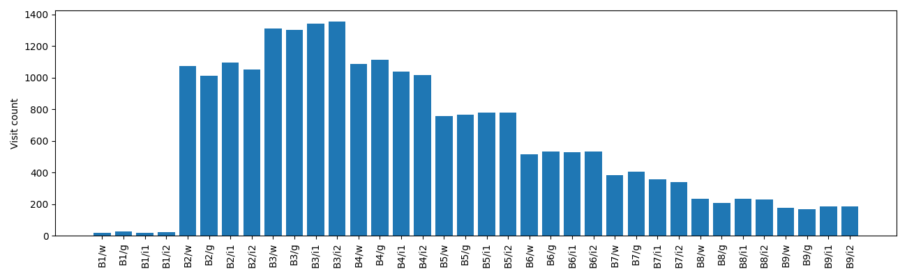
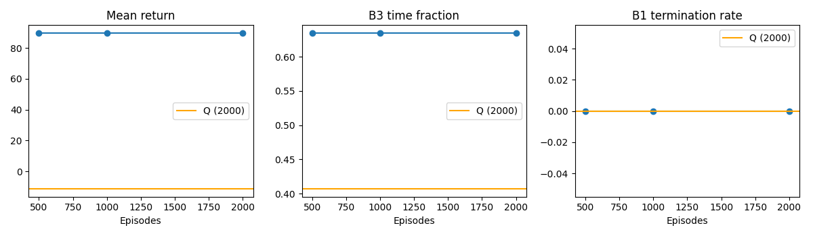
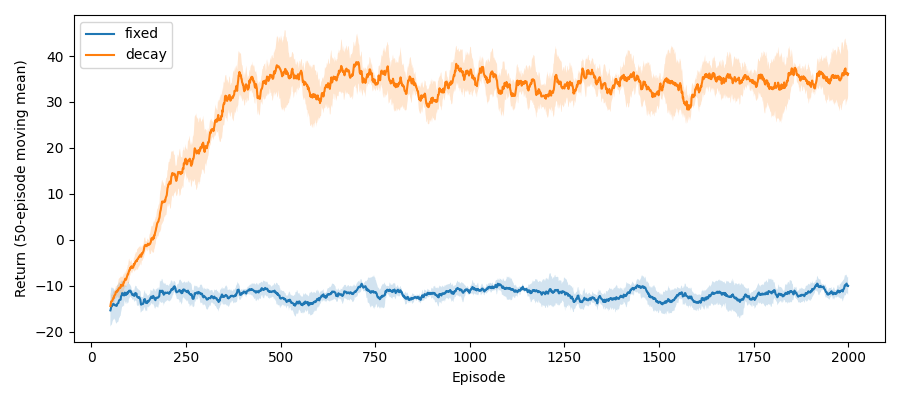

# 血糖调控实验报告

## 设计与复现
运行 `python assignment3/main.py`，依赖见 requirements.txt。课程 glucose_env.py 应置于 assignment3 的上一级。算法仅使用离散经验，不使用真实奖励表、转移表或 info 中的连续血糖。训练随机动作种子 2026、环境种子 2026+i，共 2000 条轨迹，两方法使用完全相同的数据。评估每个策略使用 500 个独立环境种子 100000+i。在线实验每种模式训练 2000 回合、5 个种子。图表及本文由 main.py 生成。

## Part A
用显式计数归一化估计 P，奖励取样本均值。未访问项使用均匀分布和零奖励，这是无数据时的对称默认值，并非可信先验。价值迭代采用同步扫描，gamma=0.9，阈值 1e-4，上限 1000 次，本次迭代 81 次。进入 B1 不再累积未来价值，但 reset 得到 B1 时仍可选动作，因此保留其动作估计。200 步上限作为评估截断；Part A 规划为平稳折扣模型，不建模剩余时间。动作平局按 w,g,i1,i2 处理。

最稀疏的六项为 [('B1', 'w', 20), ('B1', 'i1', 21), ('B1', 'i2', 23), ('B1', 'g', 29), ('B9', 'g', 167), ('B9', 'w', 177)]。这些项的经验模型方差更大，零访问的默认分布还可能产生乐观价值。

| 状态 | Part A | V | Part B |
|---|---|---|---|
| B1 | g | 0.0839 | g |
| B2 | g | 3.8381 | g |
| B3 | w | 4.5901 | g |
| B4 | i1 | 4.2563 | i1 |
| B5 | i2 | 3.6131 | i2 |
| B6 | i2 | 2.1143 | i2 |
| B7 | i2 | 0.0212 | i2 |
| B8 | i2 | -3.8071 | i2 |
| B9 | i2 | -9.2104 | i2 |

状态 B3 的 Part A 动作价值为 [('w', 4.5902), ('g', 3.4447), ('i1', 3.1923), ('i2', -1.6199)]，因此选择 w。这个选择权衡即时奖励、动作成本和进入危险状态后失去未来收益的影响。

## 评估与消融
平均回报为无折扣累计奖励；B3 比例为所有评估动作后的 B3 次数除以总步数；B1 率为进入 B1 的回合比例，不把 reset 时的 B1 算作失败。

| 方法/数据量 | 平均回报 | B3 比例 | B1 终止率 |
|---|---|---|---|
| 500 | 89.7132 | 0.6347 | 0.0000 |
| 1000 | 89.7132 | 0.6347 | 0.0000 |
| 2000 | 89.7132 | 0.6347 | 0.0000 |
| Q/2000 | -11.3192 | 0.4068 | 0.0000 |

本次三个数据量的评估指标相同，说明额外数据没有改变这些评估轨迹上的行为；这不代表模型估计完全相同，也不能证明更少数据总是足够。数据增加通常降低模型估计方差，但有限评估与离散策略切换使性能不必单调。图中橙线是完整数据训练的 Q 基线，各消融都使用共同数据前缀及相同评估种子。

## Part B
Q 初始为零，按 episode 和转移原顺序仅更新一遍，alpha=0.5。目标为 r+gamma max Q；done=True 时仅为 r，包括环境的时间上限终止。learn 不采样动作。最终 Q 表如下。

| 状态 | w | g | i1 | i2 |
|---|---|---|---|---|
| B1 | 2.5593 | 3.4022 | -9.8205 | -10.4000 |
| B2 | 2.9901 | 4.3955 | -7.6839 | -5.3038 |
| B3 | 4.3514 | 4.7238 | 3.4324 | -0.3883 |
| B4 | 4.7869 | 1.4833 | 5.5815 | 2.3431 |
| B5 | 2.7646 | 0.6651 | 4.2343 | 4.6375 |
| B6 | -0.1382 | 0.3597 | 2.4082 | 3.0275 |
| B7 | -2.3379 | -10.4688 | 0.7511 | 2.6376 |
| B8 | -4.5651 | -13.8534 | -6.8008 | -3.5523 |
| B9 | -15.1480 | -15.8439 | -11.8379 | -8.2222 |

非终止状态策略一致率为 87.5%，不同状态为 ['B3']。Part A 将经验整理成模型后反复规划；Part B 单遍更新受样本顺序、固定学习率及价值传播速度影响。模型误差也会通过 Bellman 更新传播，因此不能仅凭方法名称断言哪条路线更优。

## 在线探索

固定 epsilon=0.3；衰减模式每回合结束乘 0.995，下限 0.05。曲线是 50 回合滑动平均后跨种子的均值，阴影为一个标准差。最后窗口平均回报：固定 -9.999，衰减 36.145。固定探索持续承担随机危险动作的代价；衰减减少后期探索成本，但可能过早偏向不准确的价值估计。这里展示实际训练回报，未知最优策略，不能把曲线直接当作精确累计 Regret。

收敛要求充分访问所有状态动作、满足随机逼近条件的递减学习率，以及 gamma<1 和有界奖励。本任务满足折扣与奖励条件，但有限数据不能保证充分访问，固定 alpha=0.5 不满足通常的渐近收敛学习率条件。epsilon 下限也不能独自保证罕见状态充分访问，所以不能声称已经收敛到最优 Q。

## 讨论与反思
实现中需要特别处理终止与时间截断的不同语义，并避免离线学习中再次采样动作。小型离散空间中学模型便于重复规划和检查数据覆盖；直接学 Q 省去显式转移模型，但单遍学习可能不足。当前比较只使用一份离线训练集，评估种子相同不代表完整统计显著性检验。后续可增加训练种子、置信区间、递减学习率，或研究函数逼近。

