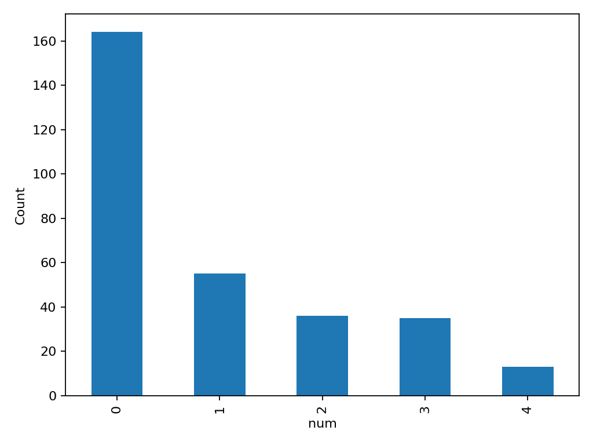
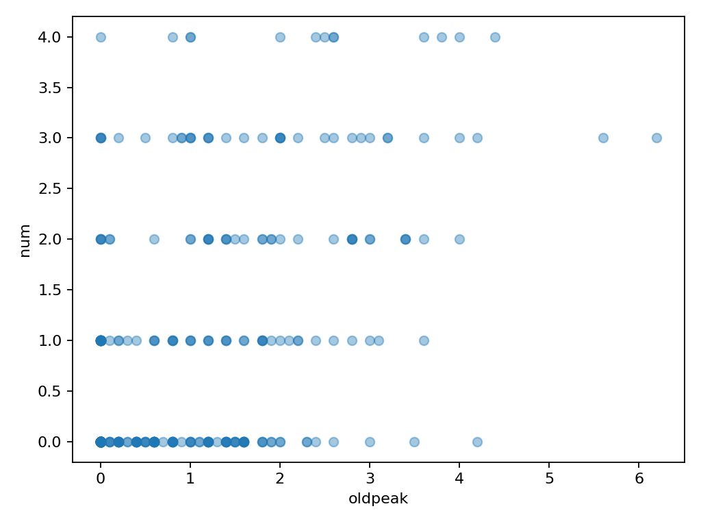
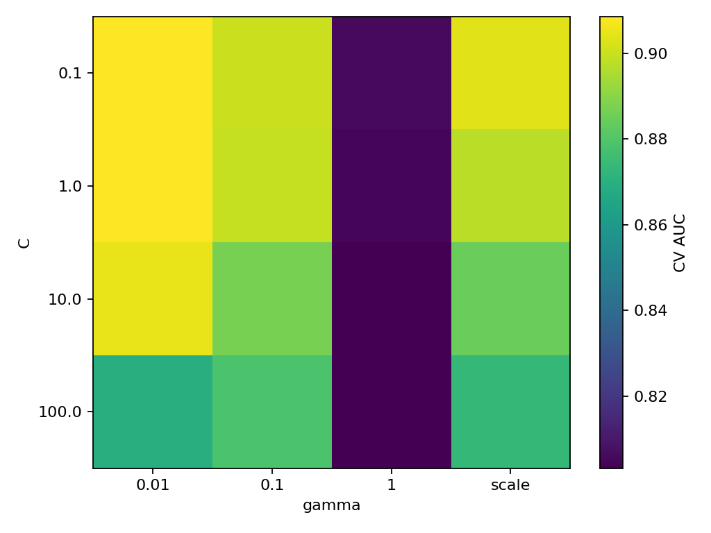
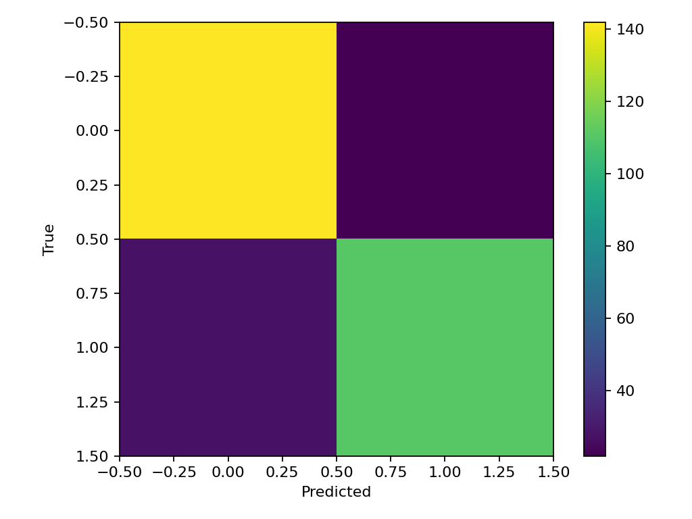
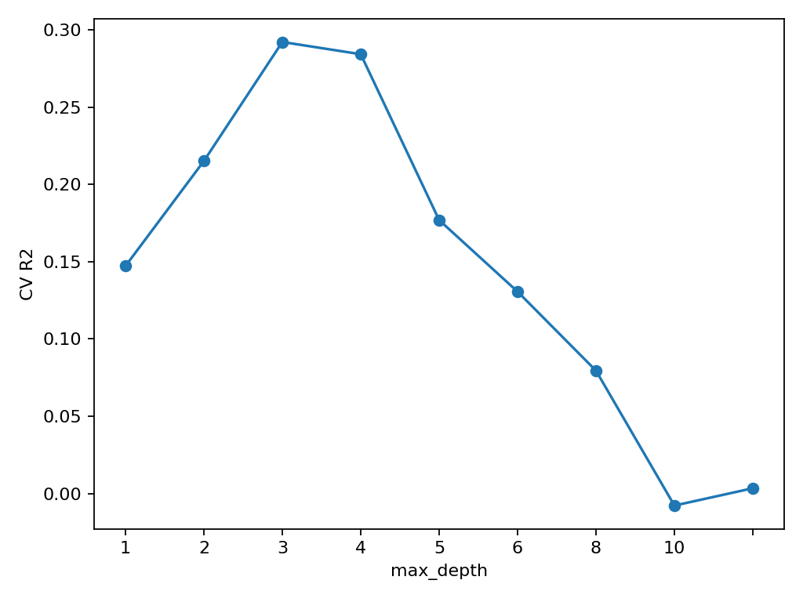
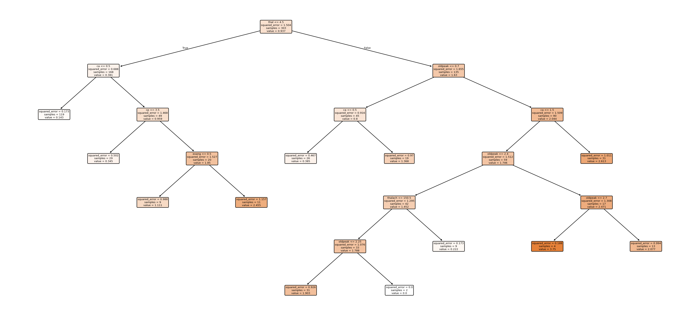

# Assignment 4 实验报告

## 设计与复现
运行 `python assignment4/main.py`，或在本目录运行 `python main.py`。课程数据放在同级的 assignment4-data。使用固定五折，种子 42；单次划分实验种子 0–9。中位数填补与标准化均在 Pipeline 中，按训练折拟合。离散编码沿用基线数值表示，不额外做独热编码，以便对齐。分类主指标 AUC，回归主指标 R²。扫描与择优使用相同五折，因此最优结果存在选择乐观偏差，不是独立测试性能；本报告按课程协议进行探索，不作临床部署结论。剪枝候选从训练折路径汇总，候选搜索也属于探索过程。

分类是 num>0，回归是 num；num 不是 ca。若改为五分类，会忽略有序距离且稀有等级样本更少。

## 数据探索
303 行，缺失 6 个单元格。用训练折中位数保留样本，避免删除带来的选择偏差。

| index    |    count |     mean |     std |      min |      25% |      50% |      75% |      max |
|:---------|---------:|---------:|--------:|---------:|---------:|---------:|---------:|---------:|
| age      | 303.0000 |  54.4389 |  9.0387 |  29.0000 |  48.0000 |  56.0000 |  61.0000 |  77.0000 |
| sex      | 303.0000 |   0.6799 |  0.4673 |   0.0000 |   0.0000 |   1.0000 |   1.0000 |   1.0000 |
| cp       | 303.0000 |   3.1584 |  0.9601 |   1.0000 |   3.0000 |   3.0000 |   4.0000 |   4.0000 |
| trestbps | 303.0000 | 131.6898 | 17.5997 |  94.0000 | 120.0000 | 130.0000 | 140.0000 | 200.0000 |
| chol     | 303.0000 | 246.6931 | 51.7769 | 126.0000 | 211.0000 | 241.0000 | 275.0000 | 564.0000 |
| fbs      | 303.0000 |   0.1485 |  0.3562 |   0.0000 |   0.0000 |   0.0000 |   0.0000 |   1.0000 |
| restecg  | 303.0000 |   0.9901 |  0.9950 |   0.0000 |   0.0000 |   1.0000 |   2.0000 |   2.0000 |
| thalach  | 303.0000 | 149.6073 | 22.8750 |  71.0000 | 133.5000 | 153.0000 | 166.0000 | 202.0000 |
| exang    | 303.0000 |   0.3267 |  0.4698 |   0.0000 |   0.0000 |   0.0000 |   1.0000 |   1.0000 |
| oldpeak  | 303.0000 |   1.0396 |  1.1611 |   0.0000 |   0.0000 |   0.8000 |   1.6000 |   6.2000 |
| slope    | 303.0000 |   1.6007 |  0.6162 |   1.0000 |   1.0000 |   2.0000 |   2.0000 |   3.0000 |
| ca       | 299.0000 |   0.6722 |  0.9374 |   0.0000 |   0.0000 |   0.0000 |   1.0000 |   3.0000 |
| thal     | 301.0000 |   4.7342 |  1.9397 |   3.0000 |   3.0000 |   3.0000 |   7.0000 |   7.0000 |

## 基线复现
基线由课程脚本独立运行，自己的代码逐折拟合并计算；没有复制脚本作为实验实现。RMSE 是平均折 MSE 的平方根，与课程脚本一致。

| model                 | metric    |   baseline |   mine |   difference |
|:----------------------|:----------|-----------:|-------:|-------------:|
| SVM (linear)          | accuracy  |     0.8349 | 0.8349 |       0.0000 |
| SVM (linear)          | precision |     0.8367 | 0.8367 |       0.0000 |
| SVM (linear)          | recall    |     0.7984 | 0.7984 |      -0.0000 |
| SVM (linear)          | f1        |     0.8153 | 0.8153 |       0.0000 |
| SVM (linear)          | auc       |     0.9105 | 0.9105 |       0.0000 |
| SVM (RBF)             | accuracy  |     0.8381 | 0.8381 |       0.0000 |
| SVM (RBF)             | precision |     0.8526 | 0.8526 |       0.0000 |
| SVM (RBF)             | recall    |     0.7839 | 0.7839 |       0.0000 |
| SVM (RBF)             | f1        |     0.8153 | 0.8153 |       0.0000 |
| SVM (RBF)             | auc       |     0.8975 | 0.8975 |      -0.0000 |
| Ridge (alpha=1)       | r2        |     0.5228 | 0.5228 |      -0.0000 |
| Ridge (alpha=1)       | mae       |     0.6348 | 0.6348 |       0.0000 |
| Ridge (alpha=1)       | rmse      |     0.8423 | 0.8423 |       0.0000 |
| Regression Tree (d=3) | r2        |     0.2922 | 0.2921 |      -0.0000 |
| Regression Tree (d=3) | mae       |     0.7121 | 0.7121 |      -0.0000 |
| Regression Tree (d=3) | rmse      |     1.0139 | 1.0139 |       0.0000 |

全部差值小于 0.01，支持当前评估流程正确。

## 总表：固定基线与扫描最优
| model                 | metric    |   baseline |   optimal |
|:----------------------|:----------|-----------:|----------:|
| SVM (linear)          | accuracy  |     0.8349 |    0.8349 |
| SVM (linear)          | precision |     0.8367 |    0.8367 |
| SVM (linear)          | recall    |     0.7984 |    0.7984 |
| SVM (linear)          | f1        |     0.8153 |    0.8153 |
| SVM (linear)          | auc       |     0.9105 |    0.9105 |
| SVM (RBF)             | accuracy  |     0.8381 |    0.8481 |
| SVM (RBF)             | precision |     0.8526 |    0.8725 |
| SVM (RBF)             | recall    |     0.7839 |    0.7841 |
| SVM (RBF)             | f1        |     0.8153 |    0.8248 |
| SVM (RBF)             | auc       |     0.8975 |    0.9086 |
| Ridge (alpha=1)       | r2        |     0.5228 |    0.5243 |
| Ridge (alpha=1)       | mae       |     0.6348 |    0.6338 |
| Ridge (alpha=1)       | rmse      |     0.8423 |    0.8411 |
| Regression Tree (d=3) | r2        |     0.2921 |    0.2921 |
| Regression Tree (d=3) | mae       |     0.7121 |    0.7121 |
| Regression Tree (d=3) | rmse      |     1.0139 |    1.0139 |

朴素分类参考：{'accuracy': 0.5412568306010929, 'precision': 0.0, 'recall': 0.0, 'f1': 0.0, 'auc': 0.5, 'train_auc': 0.5}；朴素回归参考：{'r2': -0.011652937200442182, 'mae': 1.0148398243441572, 'rmse': np.float64(1.2287650293491275)}。训练均值在测试折的 R² 不保证恰好为零，不能把全表均值的理想参考误写成实际测试结果。

我从表里读出：调参收益应逐模型逐指标比较，复杂模型并不必然领先。

## 分类扫描
| kernel   |        C | gamma   |   accuracy |   precision |   recall |     f1 |    auc |   train_auc |
|:---------|---------:|:--------|-----------:|------------:|---------:|-------:|-------:|------------:|
| linear   |   0.1000 | scale   |     0.8448 |      0.8603 |   0.7913 | 0.8225 | 0.9074 |      0.9213 |
| linear   |   1.0000 | scale   |     0.8349 |      0.8367 |   0.7984 | 0.8153 | 0.9105 |      0.9238 |
| linear   |  10.0000 | scale   |     0.8250 |      0.8237 |   0.7913 | 0.8048 | 0.9081 |      0.9232 |
| linear   | 100.0000 | scale   |     0.8250 |      0.8237 |   0.7913 | 0.8048 | 0.9081 |      0.9232 |
| rbf      |   0.1000 | scale   |     0.8480 |      0.8677 |   0.7913 | 0.8256 | 0.9038 |      0.9248 |
| rbf      |   0.1000 | 0.01    |     0.8283 |      0.9082 |   0.6981 | 0.7867 | 0.9083 |      0.9130 |
| rbf      |   0.1000 | 0.1     |     0.8414 |      0.8598 |   0.7841 | 0.8178 | 0.9002 |      0.9275 |
| rbf      |   0.1000 | 1       |     0.5413 |      0.0000 |   0.0000 | 0.0000 | 0.8059 |      1.0000 |
| rbf      |   1.0000 | scale   |     0.8381 |      0.8526 |   0.7839 | 0.8153 | 0.8975 |      0.9636 |
| rbf      |   1.0000 | 0.01    |     0.8481 |      0.8725 |   0.7841 | 0.8248 | 0.9086 |      0.9229 |
| rbf      |   1.0000 | 0.1     |     0.8415 |      0.8545 |   0.7913 | 0.8203 | 0.8995 |      0.9758 |
| rbf      |   1.0000 | 1       |     0.5807 |      0.8333 |   0.1077 | 0.1887 | 0.8044 |      1.0000 |
| rbf      |  10.0000 | scale   |     0.8150 |      0.8165 |   0.7772 | 0.7932 | 0.8845 |      0.9987 |
| rbf      |  10.0000 | 0.01    |     0.8415 |      0.8548 |   0.7913 | 0.8202 | 0.9049 |      0.9411 |
| rbf      |  10.0000 | 0.1     |     0.8017 |      0.8040 |   0.7630 | 0.7779 | 0.8871 |      1.0000 |
| rbf      |  10.0000 | 1       |     0.5940 |      0.7246 |   0.1865 | 0.2935 | 0.8032 |      1.0000 |
| rbf      | 100.0000 | scale   |     0.7918 |      0.7876 |   0.7553 | 0.7681 | 0.8733 |      1.0000 |
| rbf      | 100.0000 | 0.01    |     0.7985 |      0.8063 |   0.7479 | 0.7735 | 0.8694 |      0.9748 |
| rbf      | 100.0000 | 0.1     |     0.7917 |      0.7956 |   0.7484 | 0.7665 | 0.8787 |      1.0000 |
| rbf      | 100.0000 | 1       |     0.5940 |      0.7246 |   0.1865 | 0.2935 | 0.8032 |      1.0000 |

C 增大意味着错分惩罚增强、正则化减弱；并不是更不能容忍越界的参数值是小 C。对固定核比较训练与验证差距，可区分容量不足和过拟合。最佳设置为 {'kernel': 'linear', 'C': 1.0, 'gamma': 'scale', 'accuracy': 0.8348633879781421, 'precision': 0.8367112597547379, 'recall': 0.7984126984126985, 'f1': 0.8152620184263186, 'auc': 0.9104630130671797, 'train_auc': 0.9237653287271608}。

逐类指标采用汇总折外预测，accuracy 是整体指标，AUC 是二分类排序指标，不伪造逐类 accuracy。敏感性等于正类 recall，特异性等于负类 recall；precision 的分母是预测为该类的样本。

| index        |   precision |   recall |   f1-score |   support |
|:-------------|------------:|---------:|-----------:|----------:|
| 0            |      0.8353 |   0.8659 |     0.8503 |  164.0000 |
| 1            |      0.8346 |   0.7986 |     0.8162 |  139.0000 |
| accuracy     |      0.8350 |   0.8350 |     0.8350 |    0.8350 |
| macro avg    |      0.8349 |   0.8322 |     0.8332 |  303.0000 |
| weighted avg |      0.8350 |   0.8350 |     0.8346 |  303.0000 |

混淆矩阵（行真值，列预测）：[[142, 22], [28, 111]]。

## 回归扫描及剪枝
| model   | parameter             |      r2 |    mae |    depth |   leaves |   rmse |
|:--------|:----------------------|--------:|-------:|---------:|---------:|-------:|
| tree    | 1                     |  0.1472 | 0.8703 |   1.0000 |   2.0000 | 1.1237 |
| tree    | 2                     |  0.2152 | 0.7645 |   2.0000 |   4.0000 | 1.0709 |
| tree    | 3                     |  0.2921 | 0.7121 |   3.0000 |   8.0000 | 1.0139 |
| tree    | 4                     |  0.2842 | 0.6939 |   4.0000 |  15.8000 | 1.0231 |
| tree    | 5                     |  0.1769 | 0.7170 |   5.0000 |  27.6000 | 1.0912 |
| tree    | 6                     |  0.1306 | 0.7192 |   6.0000 |  40.8000 | 1.1287 |
| tree    | 8                     |  0.0795 | 0.7232 |   8.0000 |  67.4000 | 1.1704 |
| tree    | 10                    | -0.0078 | 0.7571 |  10.0000 |  80.4000 | 1.2154 |
| tree    | None                  |  0.0034 | 0.7491 |  11.4000 |  82.8000 | 1.2092 |
| pruned  | 0.0                   |  0.0034 | 0.7491 |  11.4000 |  82.8000 | 1.2092 |
| pruned  | 0.0020599320415665688 |  0.0173 | 0.7412 |  10.8000 |  73.8000 | 1.2007 |
| pruned  | 0.002743484224965707  |  0.0356 | 0.7548 |  10.8000 |  64.2000 | 1.1901 |
| pruned  | 0.0030864197530864196 |  0.0668 | 0.7422 |  10.4000 |  56.8000 | 1.1703 |
| pruned  | 0.0034306435438972594 |  0.0980 | 0.7333 |  10.4000 |  52.2000 | 1.1512 |
| pruned  | 0.004958677685950413  |  0.1110 | 0.7267 |   9.8000 |  45.4000 | 1.1428 |
| pruned  | 0.0063361195562287075 |  0.1292 | 0.7298 |   9.0000 |  37.4000 | 1.1309 |
| pruned  | 0.009294042351893591  |  0.1964 | 0.7067 |   7.8000 |  29.2000 | 1.0850 |
| pruned  | 0.014502032899024268  |  0.1561 | 0.7330 |   7.0000 |  21.8000 | 1.1042 |
| pruned  | 0.021754665057422632  |  0.2508 | 0.7050 |   5.4000 |  13.8000 | 1.0401 |
| pruned  | 0.03947032048883902   |  0.2419 | 0.7404 |   3.8000 |   7.4000 | 1.0462 |
| pruned  | 0.46043428811459974   | -0.0117 | 1.0148 |   0.0000 |   1.0000 | 1.2288 |
| ridge   | 1e-06                 |  0.5225 | 0.6349 | nan      | nan      | 0.8424 |
| ridge   | 0.01                  |  0.5225 | 0.6349 | nan      | nan      | 0.8424 |
| ridge   | 0.1                   |  0.5226 | 0.6349 | nan      | nan      | 0.8424 |
| ridge   | 1                     |  0.5228 | 0.6348 | nan      | nan      | 0.8423 |
| ridge   | 10                    |  0.5243 | 0.6338 | nan      | nan      | 0.8411 |
| ridge   | 100                   |  0.5202 | 0.6393 | nan      | nan      | 0.8466 |
| ridge   | 1000                  |  0.3433 | 0.8080 | nan      | nan      | 0.9938 |

预剪枝限制生长，可能错过需要多次分裂才能显现的收益；后剪枝先长树再按复杂度代价裁剪，但不保证更好。叶节点增多使每叶样本减少，局部均值方差增大，深树在未见样本上容易产生大误差。树图中的前两层以特征名称和阈值给出了分组规则；涉及 ca/thal 时依赖昂贵检查，涉及 oldpeak 时反映运动 ST 段变化，不能解释为因果效应。

以下分别按 R² 与 MAE 排序，尤其比较深度 3 与 5：平方误差对少数大误差更敏感，MAE 改善不保证 R² 改善。

| model   | parameter             |      r2 |    mae |    depth |   leaves |   rmse |
|:--------|:----------------------|--------:|-------:|---------:|---------:|-------:|
| ridge   | 10                    |  0.5243 | 0.6338 | nan      | nan      | 0.8411 |
| ridge   | 1                     |  0.5228 | 0.6348 | nan      | nan      | 0.8423 |
| ridge   | 0.1                   |  0.5226 | 0.6349 | nan      | nan      | 0.8424 |
| ridge   | 0.01                  |  0.5225 | 0.6349 | nan      | nan      | 0.8424 |
| ridge   | 1e-06                 |  0.5225 | 0.6349 | nan      | nan      | 0.8424 |
| ridge   | 100                   |  0.5202 | 0.6393 | nan      | nan      | 0.8466 |
| ridge   | 1000                  |  0.3433 | 0.8080 | nan      | nan      | 0.9938 |
| tree    | 3                     |  0.2921 | 0.7121 |   3.0000 |   8.0000 | 1.0139 |
| tree    | 4                     |  0.2842 | 0.6939 |   4.0000 |  15.8000 | 1.0231 |
| pruned  | 0.021754665057422632  |  0.2508 | 0.7050 |   5.4000 |  13.8000 | 1.0401 |
| pruned  | 0.03947032048883902   |  0.2419 | 0.7404 |   3.8000 |   7.4000 | 1.0462 |
| tree    | 2                     |  0.2152 | 0.7645 |   2.0000 |   4.0000 | 1.0709 |
| pruned  | 0.009294042351893591  |  0.1964 | 0.7067 |   7.8000 |  29.2000 | 1.0850 |
| tree    | 5                     |  0.1769 | 0.7170 |   5.0000 |  27.6000 | 1.0912 |
| pruned  | 0.014502032899024268  |  0.1561 | 0.7330 |   7.0000 |  21.8000 | 1.1042 |
| tree    | 1                     |  0.1472 | 0.8703 |   1.0000 |   2.0000 | 1.1237 |
| tree    | 6                     |  0.1306 | 0.7192 |   6.0000 |  40.8000 | 1.1287 |
| pruned  | 0.0063361195562287075 |  0.1292 | 0.7298 |   9.0000 |  37.4000 | 1.1309 |
| pruned  | 0.004958677685950413  |  0.1110 | 0.7267 |   9.8000 |  45.4000 | 1.1428 |
| pruned  | 0.0034306435438972594 |  0.0980 | 0.7333 |  10.4000 |  52.2000 | 1.1512 |
| tree    | 8                     |  0.0795 | 0.7232 |   8.0000 |  67.4000 | 1.1704 |
| pruned  | 0.0030864197530864196 |  0.0668 | 0.7422 |  10.4000 |  56.8000 | 1.1703 |
| pruned  | 0.002743484224965707  |  0.0356 | 0.7548 |  10.8000 |  64.2000 | 1.1901 |
| pruned  | 0.0020599320415665688 |  0.0173 | 0.7412 |  10.8000 |  73.8000 | 1.2007 |
| pruned  | 0.0                   |  0.0034 | 0.7491 |  11.4000 |  82.8000 | 1.2092 |
| tree    | None                  |  0.0034 | 0.7491 |  11.4000 |  82.8000 | 1.2092 |
| tree    | 10                    | -0.0078 | 0.7571 |  10.0000 |  80.4000 | 1.2154 |
| pruned  | 0.46043428811459974   | -0.0117 | 1.0148 |   0.0000 |   1.0000 | 1.2288 |

| model   | parameter             |      r2 |    mae |    depth |   leaves |   rmse |
|:--------|:----------------------|--------:|-------:|---------:|---------:|-------:|
| ridge   | 10                    |  0.5243 | 0.6338 | nan      | nan      | 0.8411 |
| ridge   | 1                     |  0.5228 | 0.6348 | nan      | nan      | 0.8423 |
| ridge   | 0.1                   |  0.5226 | 0.6349 | nan      | nan      | 0.8424 |
| ridge   | 0.01                  |  0.5225 | 0.6349 | nan      | nan      | 0.8424 |
| ridge   | 1e-06                 |  0.5225 | 0.6349 | nan      | nan      | 0.8424 |
| ridge   | 100                   |  0.5202 | 0.6393 | nan      | nan      | 0.8466 |
| tree    | 4                     |  0.2842 | 0.6939 |   4.0000 |  15.8000 | 1.0231 |
| pruned  | 0.021754665057422632  |  0.2508 | 0.7050 |   5.4000 |  13.8000 | 1.0401 |
| pruned  | 0.009294042351893591  |  0.1964 | 0.7067 |   7.8000 |  29.2000 | 1.0850 |
| tree    | 3                     |  0.2921 | 0.7121 |   3.0000 |   8.0000 | 1.0139 |
| tree    | 5                     |  0.1769 | 0.7170 |   5.0000 |  27.6000 | 1.0912 |
| tree    | 6                     |  0.1306 | 0.7192 |   6.0000 |  40.8000 | 1.1287 |
| tree    | 8                     |  0.0795 | 0.7232 |   8.0000 |  67.4000 | 1.1704 |
| pruned  | 0.004958677685950413  |  0.1110 | 0.7267 |   9.8000 |  45.4000 | 1.1428 |
| pruned  | 0.0063361195562287075 |  0.1292 | 0.7298 |   9.0000 |  37.4000 | 1.1309 |
| pruned  | 0.014502032899024268  |  0.1561 | 0.7330 |   7.0000 |  21.8000 | 1.1042 |
| pruned  | 0.0034306435438972594 |  0.0980 | 0.7333 |  10.4000 |  52.2000 | 1.1512 |
| pruned  | 0.03947032048883902   |  0.2419 | 0.7404 |   3.8000 |   7.4000 | 1.0462 |
| pruned  | 0.0020599320415665688 |  0.0173 | 0.7412 |  10.8000 |  73.8000 | 1.2007 |
| pruned  | 0.0030864197530864196 |  0.0668 | 0.7422 |  10.4000 |  56.8000 | 1.1703 |
| tree    | None                  |  0.0034 | 0.7491 |  11.4000 |  82.8000 | 1.2092 |
| pruned  | 0.0                   |  0.0034 | 0.7491 |  11.4000 |  82.8000 | 1.2092 |
| pruned  | 0.002743484224965707  |  0.0356 | 0.7548 |  10.8000 |  64.2000 | 1.1901 |
| tree    | 10                    | -0.0078 | 0.7571 |  10.0000 |  80.4000 | 1.2154 |
| tree    | 2                     |  0.2152 | 0.7645 |   2.0000 |   4.0000 | 1.0709 |
| ridge   | 1000                  |  0.3433 | 0.8080 | nan      | nan      | 0.9938 |
| tree    | 1                     |  0.1472 | 0.8703 |   1.0000 |   2.0000 | 1.1237 |
| pruned  | 0.46043428811459974   | -0.0117 | 1.0148 |   0.0000 |   1.0000 | 1.2288 |

## 正则化系数
|     alpha |     age |    sex |     cp |   trestbps |   chol |     fbs |   restecg |   thalach |   exang |   oldpeak |   slope |     ca |   thal |
|----------:|--------:|-------:|-------:|-----------:|-------:|--------:|----------:|----------:|--------:|----------:|--------:|-------:|-------:|
|    0.0000 | -0.0725 | 0.0907 | 0.1953 |     0.0762 | 0.0090 | -0.0199 |    0.0920 |   -0.1222 |  0.1155 |    0.2152 |  0.1026 | 0.4031 | 0.2571 |
|    0.0100 | -0.0725 | 0.0907 | 0.1953 |     0.0762 | 0.0090 | -0.0199 |    0.0920 |   -0.1222 |  0.1155 |    0.2152 |  0.1026 | 0.4031 | 0.2571 |
|    0.1000 | -0.0724 | 0.0907 | 0.1953 |     0.0762 | 0.0090 | -0.0198 |    0.0919 |   -0.1222 |  0.1155 |    0.2152 |  0.1026 | 0.4030 | 0.2570 |
|    1.0000 | -0.0715 | 0.0908 | 0.1951 |     0.0759 | 0.0090 | -0.0196 |    0.0918 |   -0.1221 |  0.1156 |    0.2150 |  0.1026 | 0.4017 | 0.2566 |
|   10.0000 | -0.0628 | 0.0916 | 0.1929 |     0.0732 | 0.0095 | -0.0177 |    0.0901 |   -0.1206 |  0.1165 |    0.2132 |  0.1028 | 0.3894 | 0.2523 |
|  100.0000 | -0.0127 | 0.0911 | 0.1720 |     0.0575 | 0.0126 | -0.0055 |    0.0771 |   -0.1138 |  0.1180 |    0.1934 |  0.1028 | 0.3054 | 0.2189 |
| 1000.0000 |  0.0302 | 0.0474 | 0.0829 |     0.0286 | 0.0113 |  0.0075 |    0.0365 |   -0.0734 |  0.0733 |    0.0988 |  0.0671 | 0.1164 | 0.1038 |

接近零的 alpha 近似 OLS；增大 alpha 收缩系数，但 Ridge 不执行 Lasso 式稀疏选择。系数来自全表拟合，仅用于解释，不用于计算测试指标。相关特征会分摊信号，系数大小不能当作独立因果效应；Lasso 在相关组间的选择可能不稳定。本实验主线选择 Ridge。

## 四项消融
| experiment   | model            | setting      |   accuracy |   precision |   recall |       f1 |      auc |   train_auc |       r2 |      mae |    depth |   leaves |     rmse |
|:-------------|:-----------------|:-------------|-----------:|------------:|---------:|---------:|---------:|------------:|---------:|---------:|---------:|---------:|---------:|
| features     | SVM              | all          |     0.8349 |      0.8367 |   0.7984 |   0.8153 |   0.9105 |      0.9238 | nan      | nan      | nan      | nan      | nan      |
| features     | SVM              | drop ca thal |     0.7560 |      0.7606 |   0.6979 |   0.7254 |   0.8559 |      0.8867 | nan      | nan      | nan      | nan      | nan      |
| features     | Tree             | all          |   nan      |    nan      | nan      | nan      | nan      |    nan      |   0.2921 |   0.7121 |   3.0000 |   8.0000 |   1.0139 |
| features     | Tree             | drop ca thal |   nan      |    nan      | nan      | nan      | nan      |    nan      |   0.3376 |   0.7150 |   3.0000 |   8.0000 |   0.9820 |
| features     | Ridge            | all          |   nan      |    nan      | nan      | nan      | nan      |    nan      |   0.5243 |   0.6338 | nan      | nan      |   0.8411 |
| features     | Ridge            | drop ca thal |   nan      |    nan      | nan      | nan      | nan      |    nan      |   0.3885 |   0.7310 | nan      | nan      |   0.9518 |
| split        | Tree             | 0            |   nan      |    nan      | nan      | nan      | nan      |    nan      |   0.1365 |   0.7531 |   3.0000 |   8.0000 |   1.0750 |
| split        | Tree             | 1            |   nan      |    nan      | nan      | nan      | nan      |    nan      |   0.1910 |   0.7888 |   3.0000 |   8.0000 |   1.0889 |
| split        | Tree             | 2            |   nan      |    nan      | nan      | nan      | nan      |    nan      |   0.3151 |   0.6036 |   3.0000 |   8.0000 |   0.8548 |
| split        | Tree             | 3            |   nan      |    nan      | nan      | nan      | nan      |    nan      |   0.1676 |   0.8426 |   3.0000 |   8.0000 |   1.2613 |
| split        | Tree             | 4            |   nan      |    nan      | nan      | nan      | nan      |    nan      |   0.1175 |   0.8434 |   3.0000 |   7.0000 |   1.1907 |
| split        | Tree             | 5            |   nan      |    nan      | nan      | nan      | nan      |    nan      |   0.2900 |   0.6634 |   3.0000 |   8.0000 |   0.9362 |
| split        | Tree             | 6            |   nan      |    nan      | nan      | nan      | nan      |    nan      |   0.1428 |   0.7256 |   3.0000 |   8.0000 |   1.0538 |
| split        | Tree             | 7            |   nan      |    nan      | nan      | nan      | nan      |    nan      |   0.1544 |   0.7729 |   3.0000 |   8.0000 |   1.0725 |
| split        | Tree             | 8            |   nan      |    nan      | nan      | nan      | nan      |    nan      |   0.1771 |   0.7203 |   3.0000 |   8.0000 |   1.0193 |
| split        | Tree             | 9            |   nan      |    nan      | nan      | nan      | nan      |    nan      |  -0.2008 |   0.8444 |   3.0000 |   8.0000 |   1.1415 |
| capacity     | Polynomial Ridge | 10           |   nan      |    nan      | nan      | nan      | nan      |    nan      |   0.1822 |   0.8189 | nan      | nan      |   1.0882 |
| capacity     | Polynomial Ridge | 100          |   nan      |    nan      | nan      | nan      | nan      |    nan      |   0.3788 |   0.7139 | nan      | nan      |   0.9551 |
| capacity     | Polynomial Ridge | 1000         |   nan      |    nan      | nan      | nan      | nan      |    nan      |   0.3707 |   0.7806 | nan      | nan      |   0.9709 |
| capacity     | Polynomial Ridge | 10000        |   nan      |    nan      | nan      | nan      | nan      |    nan      |   0.0944 |   0.9607 | nan      | nan      |   1.1636 |

去除 ca/thal 的变化应按模型分别比较；下降表示这些检查提供额外信息，却不代表初筛能够合法获得这些信息。树按排序阈值分裂，因此正比例缩放通常不改变分组；SVM 的距离和惩罚尺度会改变。

不标准化的完整 C 扫描：
| kernel   |        C | gamma   |   accuracy |   precision |   recall |     f1 |    auc |   train_auc |
|:---------|---------:|:--------|-----------:|------------:|---------:|-------:|-------:|------------:|
| linear   |   0.1000 | scale   |     0.8513 |      0.8622 |   0.8056 | 0.8317 | 0.9053 |      0.9172 |
| linear   |   1.0000 | scale   |     0.8348 |      0.8424 |   0.7913 | 0.8135 | 0.9087 |      0.9226 |
| linear   |  10.0000 | scale   |     0.8283 |      0.8297 |   0.7913 | 0.8076 | 0.9059 |      0.9235 |
| linear   | 100.0000 | scale   |     0.8349 |      0.8540 |   0.7770 | 0.8105 | 0.8998 |      0.9163 |
| rbf      |   0.1000 | scale   |     0.5413 |      0.0000 |   0.0000 | 0.0000 | 0.7354 |      0.7501 |
| rbf      |   0.1000 | 0.01    |     0.5413 |      0.0000 |   0.0000 | 0.0000 | 0.6228 |      0.9981 |
| rbf      |   0.1000 | 0.1     |     0.5413 |      0.0000 |   0.0000 | 0.0000 | 0.5862 |      1.0000 |
| rbf      |   0.1000 | 1       |     0.5413 |      0.0000 |   0.0000 | 0.0000 | 0.5199 |      1.0000 |
| rbf      |   1.0000 | scale   |     0.6472 |      0.6939 |   0.4259 | 0.5193 | 0.7498 |      0.7614 |
| rbf      |   1.0000 | 0.01    |     0.5773 |      0.5508 |   0.3307 | 0.4089 | 0.6197 |      0.9998 |
| rbf      |   1.0000 | 0.1     |     0.5413 |      0.0000 |   0.0000 | 0.0000 | 0.5846 |      1.0000 |
| rbf      |   1.0000 | 1       |     0.5413 |      0.0000 |   0.0000 | 0.0000 | 0.5417 |      1.0000 |
| rbf      |  10.0000 | scale   |     0.6999 |      0.7242 |   0.5767 | 0.6360 | 0.7724 |      0.7866 |
| rbf      |  10.0000 | 0.01    |     0.5444 |      0.4954 |   0.3958 | 0.4356 | 0.5913 |      1.0000 |
| rbf      |  10.0000 | 0.1     |     0.5479 |      0.4000 |   0.0146 | 0.0281 | 0.5844 |      1.0000 |
| rbf      |  10.0000 | 1       |     0.5413 |      0.0000 |   0.0000 | 0.0000 | 0.5417 |      1.0000 |
| rbf      | 100.0000 | scale   |     0.8084 |      0.8221 |   0.7410 | 0.7780 | 0.8743 |      0.8905 |
| rbf      | 100.0000 | 0.01    |     0.5444 |      0.4954 |   0.3958 | 0.4356 | 0.5913 |      1.0000 |
| rbf      | 100.0000 | 0.1     |     0.5479 |      0.4000 |   0.0146 | 0.0281 | 0.5844 |      1.0000 |
| rbf      | 100.0000 | 1       |     0.5413 |      0.0000 |   0.0000 | 0.0000 | 0.5417 |      1.0000 |

10 次单划分 R² 最小 -0.2008、最大 0.3151、标准差（ddof=1）0.1390；固定五折树深 3 的 R²=0.2921。仅凭一次划分可能选中偶然有利的测试集。多项式容量实验增加交互与平方项，也增加估计方差；强正则化缓解但不能保证收益，与深树的方差问题相通。

## 讨论题
# 讨论题

## 1. 线性核与 RBF
线性核最优 AUC 为 0.9105，RBF 为 0.9086。本次较优核是 linear，其 C=1.0、gamma=scale。非线性并不保证收益，局部边界可能放大小样本噪声。RBF 的核值 exp(-gamma*距离平方) 在 gamma 增大时迅速衰减，训练样本间的联系变弱。扫描表同时报告训练 AUC 与验证 AUC，可直接检查拟合和泛化的差距。核更换与调参的收益应分别用总表中的最优差值和基线到最优差值衡量，不能将两者混为一谈。

## 2. 两条任务线
岭回归最优 R² 为 0.5243，树族最优 R² 为 0.2921。分类最优 AUC 为 0.9105。这些数值不能跨任务直接比较大小。若线性方法在两条任务线上均有竞争力，说明当前特征中的主要信号可由较简单的关系表达。树的局部分割会减少叶中样本数，均值估计因此更不稳定。该解释只适用于当前样本和特征，不能推出真实疾病机制必然线性。

## 3. 回归作为分类器
岭回归折外预测作为连续分数的 AUC 为 0.9099，SVM 折外 AUC 为 0.9055。表中的多个阈值显示，同一排序可以产生不同的 accuracy 与 F1。SVM 折外 accuracy=0.8350、F1=0.8162。因此“排序不逊于分类器”与“某个阈值的类别判断更差”可以同时成立。回归目标 num 与 num>0 相关，所以无需直接拟合二分类标签也能得到有用排序。其局限是平方损失更关注等级误差，未直接优化零与非零的边界，且这些阈值是探索结果，部署前应在独立数据上选择。

|   threshold |   accuracy |     f1 |    auc |
|------------:|-----------:|-------:|-------:|
|      0.3000 |     0.7228 | 0.7600 | 0.9099 |
|      0.5000 |     0.7756 | 0.7888 | 0.9099 |
|      0.7000 |     0.8218 | 0.8176 | 0.9099 |
|      1.0000 |     0.8515 | 0.8289 | 0.9099 |

## 实验日志与可检验假设
1. 非线性未必改善：线性最优 AUC=0.9105，RBF=0.9086。假设小样本下局部边界增加方差；验证方式为扫描 gamma 并比较训练/验证 AUC，见分类扫描表。
2. 深树未必更好：深度 3 R²=0.2921，无限深 R²=0.0034。假设小叶子估计不稳定；通过叶数和深度扫描检查复杂度变化，后续可进一步统计叶内样本量。
3. 同一模型单划分波动：R² 范围 -0.2008–0.3151。假设测试集中严重等级的构成影响平方误差；10 个种子证实波动存在，进一步验证原因应按等级分解误差，不能把波动本身当成机制证明。

## 补充：按实际结果作出判断

linear：标准化最优 C=1.0、AUC=0.9105；不标准化最优 C=1.0、AUC=0.9087。最优 C 的变化说明其含义依赖特征尺度。

rbf：标准化最优 C=1.0、AUC=0.9086；不标准化最优 C=100.0、AUC=0.8743。最优 C 的变化说明其含义依赖特征尺度。

SVM 删除 ca/thal 前 auc=0.9105，删除后 0.8559，变化 -0.0546。

Tree 删除 ca/thal 前 r2=0.2921，删除后 0.3376，变化 +0.0455。

Ridge 删除 ca/thal 前 r2=0.5243，删除后 0.3885，变化 -0.1359。

本次预剪枝最佳 R²=0.2921，后剪枝最佳 R²=0.2508；当前搜索范围内预剪枝更好，不能据此证实后剪枝总能避免剪早而提高成绩。

指标逆序的具体例子：tree(1.0) R²=0.1472、MAE=0.8703；tree(6.0) R²=0.1306、MAE=0.7192。在这两者中按 R² 选前者，按 MAE 选后者。全体候选按 R² 的最佳为 ridge(10.0)，按 MAE 的最佳为 ridge(10.0)；局部逆序不一定改变全局最佳。

相关性最大的五对特征：[(np.float64(0.5775368167291409), 'slope', 'oldpeak', np.float64(0.5775368167291409)), (np.float64(0.39380580598682063), 'thalach', 'age', np.float64(-0.39380580598682063)), (np.float64(0.3856011620787403), 'slope', 'thalach', np.float64(-0.3856011620787403)), (np.float64(0.38405952636486906), 'exang', 'cp', np.float64(0.38405952636486906)), (np.float64(0.38093583491374833), 'thal', 'sex', np.float64(0.38093583491374833))]。相关性为探索性全表描述，不参与预处理拟合。

为核验讲义关于 Lasso 的论断，增加辅助实验（不替代 Ridge 主线）：

|   alpha |   zero_coefficients |         r2 |      mae |     rmse |
|--------:|--------------------:|-----------:|---------:|---------:|
|    0.01 |                   1 |  0.525461  | 0.632992 | 0.840237 |
|    0.1  |                   4 |  0.507696  | 0.641278 | 0.858773 |
|    1    |                  13 | -0.0116529 | 1.01484  | 1.22877  |
|   10    |                  13 | -0.0116529 | 1.01484  | 1.22877  |

剪枝树前两层的实际规则：

- 节点 0: thal <= 4.500，样本数 303。这是按该检查指标将病例分组，叶值表示组内平均严重程度，不能解释为因果或独立诊断标准。

- 节点 1: ca <= 0.500，样本数 168。这是按该检查指标将病例分组，叶值表示组内平均严重程度，不能解释为因果或独立诊断标准。

- 节点 8: oldpeak <= 0.700，样本数 135。这是按该检查指标将病例分组，叶值表示组内平均严重程度，不能解释为因果或独立诊断标准。

## 分类与回归汇总（宽表）

| model           |   baseline_accuracy |   baseline_precision |   baseline_recall |   baseline_f1 |   baseline_auc |   optimal_accuracy |   optimal_precision |   optimal_recall |   optimal_f1 |   optimal_auc |
|:----------------|--------------------:|---------------------:|------------------:|--------------:|---------------:|-------------------:|--------------------:|-----------------:|-------------:|--------------:|
| linear          |              0.8349 |               0.8367 |            0.7984 |        0.8153 |         0.9105 |             0.8349 |              0.8367 |           0.7984 |       0.8153 |        0.9105 |
| rbf             |              0.8381 |               0.8526 |            0.7839 |        0.8153 |         0.8975 |             0.8481 |              0.8725 |           0.7841 |       0.8248 |        0.9086 |
| Naive reference |              0.5413 |               0.0000 |            0.0000 |        0.0000 |         0.5000 |             0.5413 |              0.0000 |           0.0000 |       0.0000 |        0.5000 |

我从这张表里读出：调参提升幅度有限，但模型明显优于朴素参考，比较时必须固定指标口径。

| model           |   baseline_r2 |   baseline_mae |   baseline_rmse |   optimal_r2 |   optimal_mae |   optimal_rmse |
|:----------------|--------------:|---------------:|----------------:|-------------:|--------------:|---------------:|
| Tree            |        0.2921 |         0.7121 |          1.0139 |       0.2921 |        0.7121 |         1.0139 |
| Ridge           |        0.5228 |         0.6348 |          0.8423 |       0.5243 |        0.6338 |         0.8411 |
| Naive reference |       -0.0117 |         1.0148 |          1.2288 |      -0.0117 |        1.0148 |         1.2288 |

我从这张表里读出：调参提升幅度有限，但模型明显优于朴素参考，比较时必须固定指标口径。
